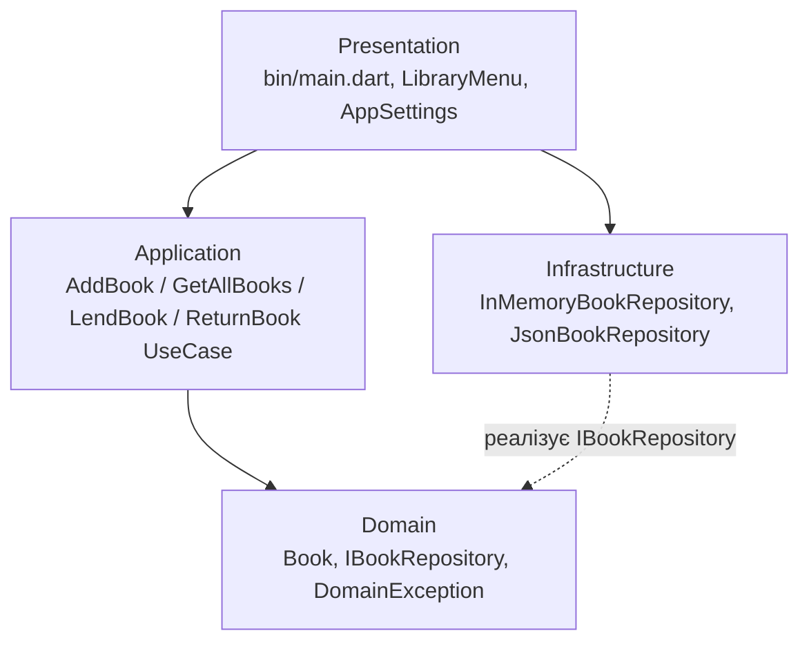

# library_app — облік книг бібліотеки

Консольний застосунок на **Dart** для обліку книг: додавання до каталогу, перегляд, видача читачу та повернення.
Побудований за принципами **Clean Architecture** (лабораторна робота №5, «Сучасні технології проєктування»).

## Use cases

| Use case | Клас | Опис |
|---|---|---|
| Додати книгу | `AddBookUseCase` | створює книгу з перевіркою назви, автора й року |
| Переглянути каталог | `GetAllBooksUseCase` | список книг, відсортований за назвою |
| Видати книгу | `LendBookUseCase` | видає книгу, якщо вона в наявності |
| Повернути книгу | `ReturnBookUseCase` | повертає видану книгу |

## Схема архітектури



Стрілки показують напрямок залежностей: **зовнішні шари залежать від внутрішніх, а не навпаки**.
Domain не імпортує жодного іншого шару. Інтерфейс `IBookRepository` оголошено в Domain,
а реалізації — в Infrastructure. Application працює лише через інтерфейс, тому спосіб
зберігання змінюється в `appsettings.json` без зміни бізнес-логіки.

## Структура каталогів

```
library_app/
├── appsettings.json                 # тип сховища: Json або InMemory
├── pubspec.yaml
├── bin/
│   └── main.dart                    # точка входу, Composition Root (DI)
└── lib/
    ├── domain/
    │   ├── entities/book.dart
    │   ├── exceptions/domain_exception.dart
    │   └── interfaces/i_book_repository.dart
    ├── application/
    │   ├── exceptions/book_not_found_exception.dart
    │   └── use_cases/
    │       ├── add_book_use_case.dart
    │       ├── get_all_books_use_case.dart
    │       ├── lend_book_use_case.dart
    │       └── return_book_use_case.dart
    ├── infrastructure/
    │   └── repositories/
    │       ├── in_memory_book_repository.dart
    │       └── json_book_repository.dart
    └── presentation/
        ├── cli/library_menu.dart
        └── configuration/app_settings.dart
```

## Збірка та запуск

Потрібен [Dart SDK](https://dart.dev/get-dart) 3.3 або новіший.

```bash
git clone <посилання-на-репозиторій>
cd library_app
dart pub get
dart run
```

Без встановлення Dart код можна перевірити на [dartpad.dev](https://dartpad.dev) (однофайлова версія).

## Налаштування сховища

`appsettings.json`:

```json
{
  "Storage": {
    "Type": "Json",
    "FilePath": "data/library.json"
  }
}
```

`Type`: `Json` або `InMemory`.

## Модель гілкування

- `main` — стабільний код (реліз `v1.0.0`);
- `develop` — інтеграційна гілка;
- `feature/*` — гілка під кожен шар / задачу, зливається в `develop` через pull request.

Коміти — за [Conventional Commits](https://www.conventionalcommits.org/): `feat`, `fix`, `refactor`, `docs`, `chore`, `merge`.
